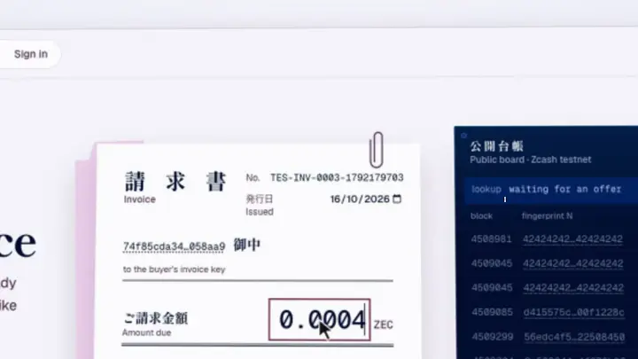
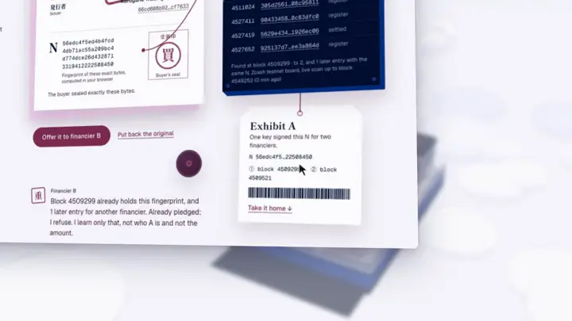
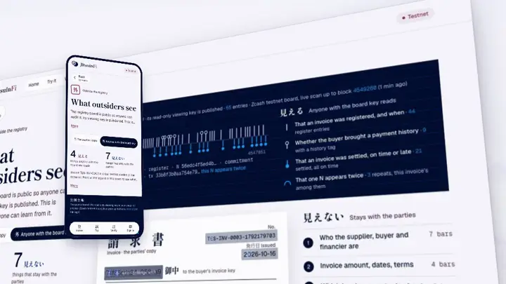
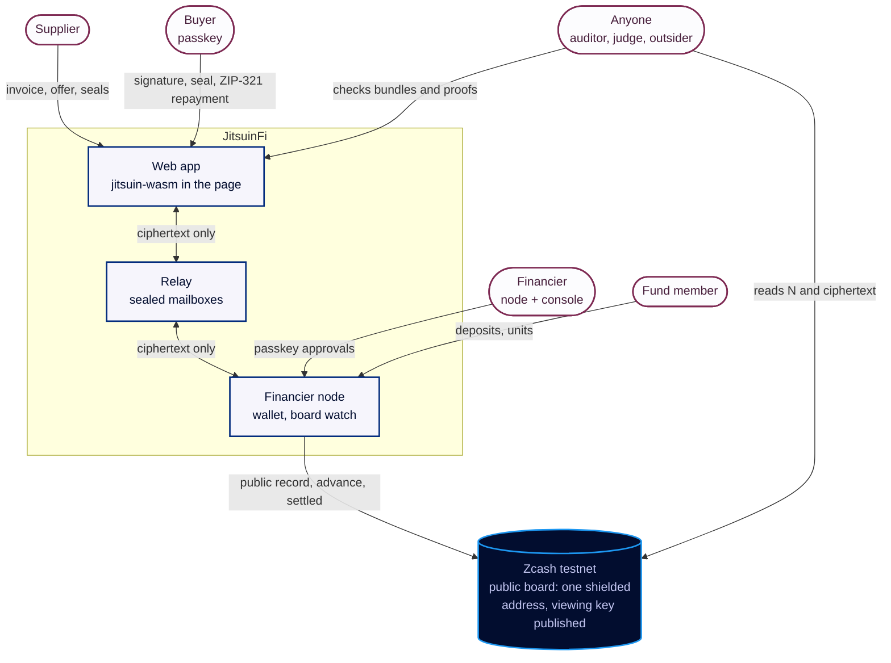
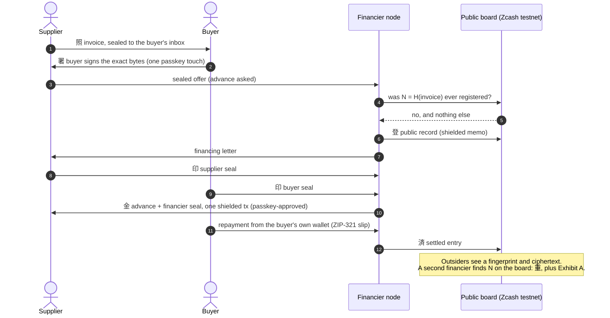
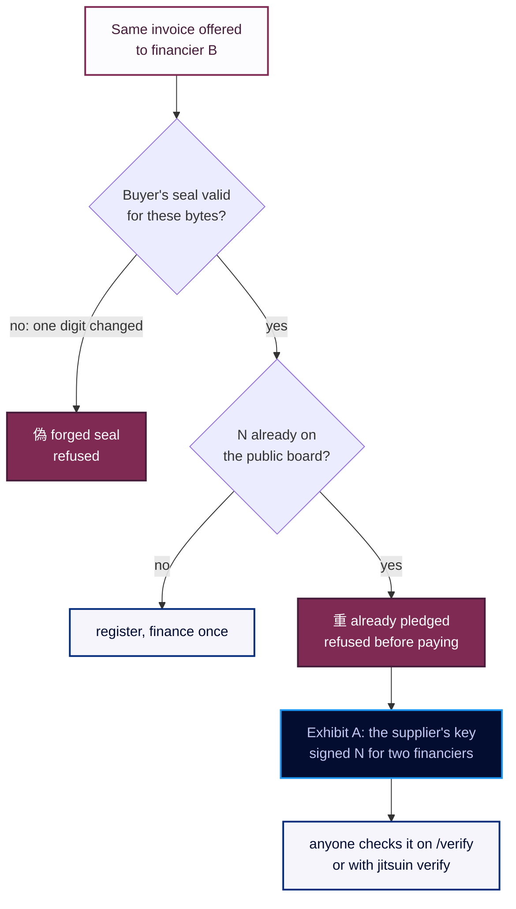
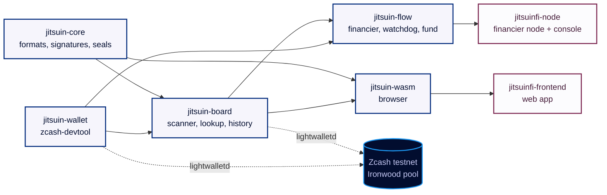
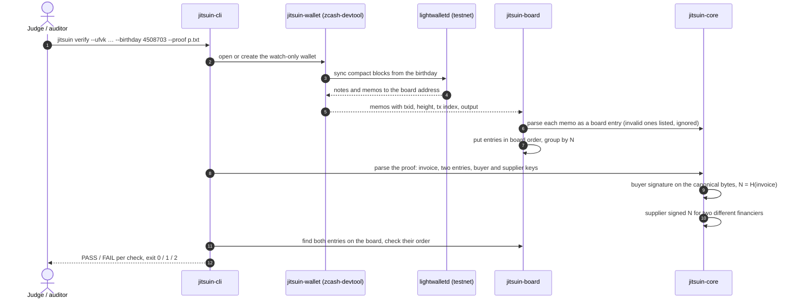

<p align="center">
  <a href="https://jitsuinfi.vercel.app"></a>
</p>

<p align="center">
  
  
  
  
  
</p>

<p align="center">
  <b>The Zcash protocol and integration layer of JitsuinFi: private invoice financing without double financing.</b>
</p>

<p align="center">
  <a href="https://jitsuinfi.vercel.app"><b>Landing</b></a> ·
  <a href="https://jitsuinfi.vercel.app/app"><b>App</b></a> ·
  <a href="https://jitsuinfi.vercel.app/try"><b>Try to double-finance</b></a> ·
  <a href="https://jitsuinfi.vercel.app/verify"><b>Verify</b></a> ·
  <a href="https://jitsuinfi-console-demo.vercel.app/console"><b>Console demo</b></a> ·
  <a href="https://youtu.be/RB9hKSLarJo"><b>2-min video</b></a>
</p>

<p align="center">
  <a href="https://youtu.be/RB9hKSLarJo"></a>
  <br><sub>Two minutes: the idea, a double-financing attempt caught live on the testnet board, and a whole deal from supplier to settlement.</sub>
</p>

## The idea in one breath

A supplier sells an invoice to a financier for cash today. The classic fraud is selling the **same invoice twice**. Registries that stop it either see every deal (a central operator) or publish who supplies whom (a public chain). **JitsuinFi does neither.** The buyer seals the invoice with a passkey; only its fingerprint **N** goes on a public board, one shielded Zcash address whose viewing key is published on purpose. Before paying, any financier asks the board one question, *was N ever registered?*, and learns nothing else.

<p align="center"></p>

<table>
  <tr>
    <td width="50%" valign="top"><br><b>偽 then 重, on the live board</b><br><sub>Change one digit and the buyer's seal breaks (偽). Offer it as it is and the testnet board already holds its fingerprint (重).</sub></td>
    <td width="50%" valign="top"><br><b>Exhibit A, portable proof</b><br><sub>The second financier takes home the supplier's double signature, then anyone checks it on /verify, in the browser.</sub></td>
  </tr>
  <tr>
    <td width="50%" valign="top"><br><b>真, a real settled deal</b><br><sub>A production testnet deal handed to /verify on a phone: every seal checks out, its public record and settled entry are on the board.</sub></td>
    <td width="50%" valign="top"><br><b>What outsiders see</b><br><sub>A fingerprint and ciphertext. No parties, no amounts; rate classes appear only from k = 5 invoices.</sub></td>
  </tr>
</table>

## How it works

**Who talks to whom.** Every arrow that crosses the relay carries ciphertext only; the chain carries a fingerprint, ciphertext and shielded payments.



**One deal, end to end** (the app shows it as the route above):



**How a second financing is caught:**



**The crates:**



## Flow in this repo (protocol and CLI)

The crates are pure functions plus a scanner: `jitsuin-core` decides what is valid, `jitsuin-board` decides what the board says, `jitsuin-flow` decides what a role does next.

**Sequence: `jitsuin verify` checks a proof against the live board**



**DFD: from an invoice to a verdict**

```mermaid
flowchart LR
    BUY[Buyer]:::human
    SUP[Supplier]:::human
    FIN[Financier]:::human
    ANY[Anyone<br/>judge, outsider]:::human
    ZC[Zcash testnet<br/>board address]:::zcash
    P1((1.0<br/>Canonical invoice,<br/>N = H)):::seal
    P2((2.0<br/>Sign and seal<br/>Jitsuin Seal)):::seal
    P3((3.0<br/>Board entry,<br/>commitment)):::sys
    P4((4.0<br/>Scan, order,<br/>lookup N)):::zcash
    P5((5.0<br/>Settle,<br/>buyer history)):::sys
    P6((6.0<br/>Verify bundle,<br/>proof, index)):::sys
    D1[(Board wallet<br/>watch-only, UFVK)]:::store
    D2[(Board snapshot<br/>--save-board JSON)]:::store
    D3[(Deal bundle, proof,<br/>Exhibit A files)]:::store
    SUP -- invoice fields, PDF hash --> P1
    P1 -- canonical bytes, N --> P2
    BUY -- buyer signature --> P2
    SUP -- supplier seal --> P2
    P2 -- signed entry --> P3
    FIN -- commitment, classes --> P3
    P3 -- shielded memo --> ZC
    ZC -- memos --> D1
    D1 --> P4
    P4 -- board --> D2
    P4 -- found / not found --> FIN
    FIN -- repayment, settled entry --> P5
    P5 -- settled memo --> ZC
    P5 -- bundle --> D3
    ANY -- files --> P6
    D3 --> P6
    D2 -- board --> P6
    P6 -- PASS / FAIL, rate classes --> ANY
    classDef human fill:#FCFCFE,stroke:#7E2A53,color:#461D3A,stroke-width:2px
    classDef zcash fill:#020D2F,stroke:#1D97F1,color:#C4C7F2,stroke-width:2px
    classDef sys fill:#F6F5FC,stroke:#032C7D,color:#020D2F,stroke-width:2px
    classDef seal fill:#7E2A53,stroke:#461D3A,color:#FCFCFE,stroke-width:2px
    classDef store fill:#ECD0EC,stroke:#7E2A53,color:#461D3A,stroke-width:1px
```


<sub>DFD legend: rectangles are external entities, circles are processes, cylinders are data stores; arrows carry the named data.</sub>

No server, no admin, no login: the registry is one Zcash address and a viewing key we published on purpose. Before paying, any lender looks up an invoice's fingerprint on that board and learns only whether it was already financed.

**What it does not stop.** A fake invoice that the buyer itself co-signs is out of scope: the buyer's signature is real, so the board sees a new invoice. Nor does it stop one delivery split into two invoices the buyer both signs, or a financier that skips the board. Credit diligence still applies.

Crates:
- `crates/jitsuin-core`: canonical invoices, nullifier, board entries, receipts, Jitsuin Seal (chained multi-party signatures), assignment letter, settlement, buyer history chain, verification bundle, double-signature proof. Pure logic, no network.
- `crates/jitsuin-wallet`: wallet backend wrapping `zcash-devtool` (sync, ZIP-321 payments with memos, transaction listing).
- `crates/jitsuin-board`: registry board scanner (watch-only wallet + lightwalletd), ordering, double financing lookup, settled entries, buyer history checks. Network code behind the default `net` feature.
- `crates/jitsuin-flow`: role flows: financier state machine with Sign-to-Pay, supplier and buyer helpers, repayment watchdog, minimum standard before registration.
- `crates/jitsuin-wasm`: the browser side: buyer keys from a passkey PRF output, invoice and letter signing, repayment QR, client-side verification of bundles, proofs and histories.
- `crates/jitsuin-cli`: the `jitsuin` command line. `jitsuin verify` scans the board with its viewing key and checks double-signature proofs and verification bundles on it.

## For judges: verify the testnet board

The registry board is a receive-only shielded account on Zcash testnet. Its unified full viewing key (UFVK) is published on purpose: it reads every board memo and cannot spend. You need no spending key, no ZEC and no account, and nothing here asks the team anything.

| | |
|---|---|
| Network | Zcash testnet |
| Board UFVK | [`examples/testnet/board-ufvk.txt`](examples/testnet/board-ufvk.txt) (`uviewtest1…`) |
| Birthday (first block of the board) | `4508703` |
| Double-financing proof | [`examples/testnet/proof-tes-inv-0003.txt`](examples/testnet/proof-tes-inv-0003.txt) |
| Exhibit A (the same double signature without the invoice) | [`examples/testnet/exhibit-tes-inv-0003.txt`](examples/testnet/exhibit-tes-inv-0003.txt) |
| Board snapshot | [`examples/testnet/board-snapshot.json`](examples/testnet/board-snapshot.json), entries up to block 4511024, captured 2026-10-20. The live board has grown since (55 entries, tip 4547279, on 2026-10-27); the snapshot stays fixed so CI can compare output byte for byte. |
| Financier console, demo | <https://jitsuinfi-console-demo.vercel.app/console>: a sandbox testnet node; create a passkey, no invite, and see the sealed mailbox and the deal pipeline. Nothing there moves money. |

**1. Scan the live board and check the proof.** From the repository root:

```bash
docker build -t jitsuin .
docker run --rm -v jitsuin-board:/work/wallet-board-testnet jitsuin verify --ufvk "$(cat examples/testnet/board-ufvk.txt)" --birthday 4508703 --proof examples/testnet/proof-tes-inv-0003.txt
```

The first run creates a watch-only wallet and syncs from block 4508703 (about 20 s on 2026-10-20); the volume keeps it for later runs. The output lists every entry in board order and ends with:

```
  PASS  first entry: on the board at 4509299/2/0 (txid 33b8f3b0aa754e790e9c7fac0ae7dc08ce8612a8c26620d551d790e1ea390a56)
  PASS  second entry: on the board at 4509521/3/0 (txid 05d5aa7a02a33c14d460922468745fb4d6d814daa83989eed22b21c0540c79eb)
  PASS  order: the first entry came before the second
  => DOUBLE FINANCING PROVEN

Result   PASS (4 check(s), 0 failed)
```

What it shows: for test invoice `TES-INV-0003-1792179703`, signed by the buyer, the supplier's key signed the same invoice nullifier (N `56edc4f5ed4b…`) for two different financiers. Entry A (block 4509299) registered first; entry B (block 4509521) is the second attempt, and the second financier's lookup reports it as double financed. Lines marked `rejected` are board outputs whose memo is not a valid entry: anyone can send to the board, so the verifier lists such memos and ignores them. Exit status `0` means every check holds.

**2. Recompute the public rate index** from the same wallet:

```bash
docker run --rm -v jitsuin-board:/work/wallet-board-testnet jitsuin index --ufvk "$(cat examples/testnet/board-ufvk.txt)" --birthday 4508703
```

On 2026-10-20 it ends with (a later scan may count entries posted since):

```
         9 register entries, 6 invoices (each N once, first entry), 0 not disclosed, 0 invalid

  tenor          invoices  median discount  discount classes (invoices)
  <= 30 days     -         -                fewer than 5 invoices
  31-60 days     -         -                fewer than 5 invoices
  61-90 days     -         -                fewer than 5 invoices
  91-180 days    -         -                fewer than 5 invoices
  181-365 days   -         -                fewer than 5 invoices
```

The testnet board then held 6 invoices, so every tenor class shows `fewer than 5 invoices`: a class is published only from k = 5 invoices, which keeps single deals from being read off the index.

On 2026-10-22 five more test invoices were registered with their real classes (`TES-INV-IDX-…`, 45-day tenor, discounts 2 % to 6 %, registration only; [`crates/jitsuin-flow/examples/testnet_index.rs`](crates/jitsuin-flow/examples/testnet_index.rs)). The same command then publishes its first class:

```
  31-60 days     5         3-5%             other: 5
```

Each discount class alone still holds fewer than 5 invoices, so they are shown together as `other`. Entries and full output: [`examples/testnet/index-tes-inv-idx/`](examples/testnet/index-tes-inv-idx/).

**3. Offline, without the network.** The image holds the snapshot, so no volume is needed:

```bash
docker run --rm jitsuin verify --board examples/testnet/board-snapshot.json --proof examples/testnet/proof-tes-inv-0003.txt
docker run --rm jitsuin index --board examples/testnet/board-snapshot.json
```

They print exactly [`examples/testnet/expected-output.txt`](examples/testnet/expected-output.txt) and [`examples/testnet/expected-index.txt`](examples/testnet/expected-index.txt); `cargo test` in CI checks both files byte for byte. Add `--save-board mine.json` to the live scan in step 1 to write your own snapshot; it holds the same entries, plus any posted after the capture.

**4. In the browser:** open <https://jitsuinfi.vercel.app/verify>, press "Use Case File #0417's Exhibit A" or paste a proof, bundle or Exhibit A, and press "Hand it to the registry". The page reads the live board by itself (or a board file you add) and runs the same checks compiled to WebAssembly, in the page.

**5. A whole deal, end to end.** On 2026-10-22 one test invoice backed by a real PDF, `TES-INV-E2E1-77210` (100 000 zat, due in 30 days), went through the full cycle on testnet: the buyer signed the invoice bytes, the financier registered N, the supplier, the buyer and the financier sealed the assignment letter, the financier paid the 90 000 zat advance, the buyer repaid the financier directly and the settled entry closed the deal. A second financier was then offered the same invoice and caught it. The files are in [`examples/testnet/e2e-tes-inv-e2e1/`](examples/testnet/e2e-tes-inv-e2e1/):

| Step | Testnet txid |
|---|---|
| Register entry (block 4527411) | `62ff4a57068eb71ef50b78a692369d1c6ed1e968c0891e15cc4a8e39fb35a910` |
| Advance, financier to supplier | `a8130e334146727bd13e548a9cd8972bb8f8efa39600e418cfd6cd7e0634e9a0` |
| Repayment, buyer to financier | `f14249878530eff63ae72a02748ca8ed12b0026a7ed40432743b706f47946517` |
| Settled entry (block 4527419, on time) | `0c377146708c758eae644e15e3e7f89c398ed043c6416503579b56c4c8efdbb9` |

The advance and the repayment are shielded payments, so a block explorer shows only that a transaction exists; the two board entries read with the board UFVK. Check the deal and the second offer against the live board:

```bash
docker run --rm -v jitsuin-board:/work/wallet-board-testnet jitsuin verify --ufvk "$(cat examples/testnet/board-ufvk.txt)" --birthday 4508703 --bundle examples/testnet/e2e-tes-inv-e2e1/bundle.txt --proof examples/testnet/e2e-tes-inv-e2e1/proof.txt
```

It ends with `=> DOUBLE FINANCING PROVEN`, `=> DEAL VERIFIED` and `Result   PASS (5 check(s), 0 failed)`; the full output is [`verify-output.txt`](examples/testnet/e2e-tes-inv-e2e1/verify-output.txt). The bundle's invoice carries `terms_hash`, the SHA-256 of [`invoice.pdf`](examples/testnet/e2e-tes-inv-e2e1/invoice.pdf), and its assignment letter the hash of [`letter.pdf`](examples/testnet/e2e-tes-inv-e2e1/letter.pdf). The program that ran the cycle is [`crates/jitsuin-flow/examples/testnet_cycle.rs`](crates/jitsuin-flow/examples/testnet_cycle.rs); it needs two funded testnet wallets and the board's watch-only wallet, and its header says how to run it.

**6. Through the live web app and console (production, testnet).** These deals ran on <https://jitsuinfi.vercel.app>, the financier console and the hosted financier node. `TES-INV-JUDGE3-9161` was clicked through from the installed app, with no typed URL; the other two show the console stopping a deal whose invoice is already on the board:

| Deal | Step | Testnet txid |
|---|---|---|
| `TES-INV-JUDGE3-9161` (2026-10-27) | Register entry (block 4545839) | `35ed74696145f5838188dffe49ef9a51cd5ae054f3de97044ec8855ed859bd55` |
| | Advance, approved with the console passkey | `1de9e9473d3e6b01f9037820908bca77a20891f203d95fe372886abb8343f48f` |
| | Repayment by the buyer's ZIP-321 QR | `668d0e0f3cca380dff846b936390a9526992de717260012fac6d0efd316d331a` |
| | Settled entry (block 4545868) | `208d9d573bc39e3e80d9771eb22695b5d666622576bffb790369c06f619735ba` |
| `TES-INV-MOB5-23913` (2026-10-28, phone run) | Public record | `b72a5bedc3842051acaec418db8d7236b7ff64894613e3d7263aca5072087cb1` |
| | Advance, approved with the console passkey | `1405c169793c207b11ac70939b255e43648f4ad5bc63b7672b6d1a2e83ed5f0c` |
| | Repayment by the buyer's ZIP-321 slip | `c4834e0a72bc096426835e1989fdf214a507401954e8158c9c0129e9c2c60d45` |
| | Settled entry | `7035b7547685dde5976aad140a585c62e332365d58249c053b4c3652b2242c95` |
| `TES-INV-R6-63926` and `TES-INV-R6-63926-2` (2026-10-28) | Repeat invoices, same buyer and supplier: settled entries | `2cd44c59edaa5aeac4bc063882d6cb29160f09a737b17c2e76a011c925670485`, `e6cdc728914cee7dbc13aa1e918667356460c456516eb8908b68749acfbcd611` |
| `TES-INV-DBL-24689` (2026-10-25) | First entry, production node (block 4540314) | `a2f46ffdeebef1e0fa4de74b8b2bb26083a48cb9528a72ab7ac26914a7103659` |
| | Second financier's entry (block 4540315): the console stops the deal as `DoubleFinanced` | `a42152b0ed19b5f54437ddfe61bc44b811dd3d405e78b863f3b060f237709188` |
| `TES-INV-ALR-71337` (2026-10-25) | Earlier entry (block 4540347): the console stops as `AlreadyFinanced` before paying | `25a78d45bc2ab59a5f48fff8b594cdc0bdc9cf1e218a36bd7ae8cbcb51bf75b5` |

The board entries read with the board UFVK above (`jitsuin verify --ufvk …` lists them; the hosted node also serves the board it scans at <https://financier-node-production.up.railway.app/node/board>). The advance and the repayment are shielded payments, so an explorer shows only that they exist.

Without Docker, see [With cargo](#with-cargo) below and run the same commands with `jitsuin` instead of `docker run … jitsuin`.

## Specification

[Shielded Receivable Registry](docs/zip-shielded-receivable-registry.md): ZIP-style specification of every format and rule, with test vectors asserted by the unit tests.

## Build the browser package

<details>
<summary>Open the reference</summary>

```bash
rustup target add wasm32-unknown-unknown
cargo install wasm-bindgen-cli --version 0.2.129 --locked
cargo build -p jitsuin-wasm --target wasm32-unknown-unknown --release
wasm-bindgen --target web --out-dir pkg target/wasm32-unknown-unknown/release/jitsuin_wasm.wasm
```

`pkg/` then holds `jitsuin_wasm.js` and `jitsuin_wasm_bg.wasm` for the frontend. Secrets passed to it (the buyer's master secret, a supplier key) stay in the page; the package does no network I/O.

</details>

## Verify the board (`jitsuin verify`)

<details>
<summary>Open the reference</summary>

Anyone can check the registry board without a spending key and without ZEC: the board's viewing key only reads. `jitsuin verify` lists every entry in board order, then checks each double-signature proof (`--proof`), Exhibit A (`--exhibit`, the proof without the invoice: shareable, it shows the key signed N twice on the board but not which invoice) and verification bundle (`--bundle`) against the board. Exit status: `0` every check holds, `1` a check failed, `2` usage, input or network error.

### With Docker

```bash
docker build -t jitsuin .
docker run --rm jitsuin verify --board examples/verify/board-sample.json   --proof examples/verify/proof-sample.txt --bundle examples/verify/bundle-sample.txt
```

The output must equal [`examples/verify/expected-output.txt`](examples/verify/expected-output.txt), ending in `Result   PASS (7 check(s), 0 failed)`. The sample board is synthetic (txids `a1a1…`); `crates/jitsuin-cli/tests/samples.rs` rebuilds it from fixed keys and CI checks it byte for byte.

Live scan of the board. The first run creates a watch-only wallet from the board's UFVK and needs the board's first block; the named volume keeps the wallet, so later runs only sync new blocks:

```bash
docker run --rm -v jitsuin-board:/work/wallet-board-testnet jitsuin verify   --ufvk "$(cat examples/testnet/board-ufvk.txt)" --birthday 4508703
```

To check your own proof or bundle, mount its folder and pass the path: `-v "$PWD":/in:ro ... --proof /in/proof.txt`.

### With cargo

Rust 1.99.1. The live scan also needs `zcash-devtool` at the commit `jitsuin-wallet` is tested against:

```bash
cargo install --locked --git https://github.com/zcash/zcash-devtool --rev b532d4cd760d30213c961fe0638ee6b6e1bf8e30 zcash-devtool
cargo install --locked --path crates/jitsuin-cli
jitsuin verify --board examples/verify/board-sample.json --proof examples/verify/proof-sample.txt --bundle examples/verify/bundle-sample.txt
```

`jitsuin verify --help` lists every option (`--wallet-dir`, `--devtool` or `$JITSUIN_DEVTOOL`, `--lightwalletd`, `--save-board` to write a snapshot after a live scan, `--json`).

</details>

## Public rate index (`jitsuin index`)

<details>
<summary>Open the reference</summary>

"Price public, participants private": each register entry carries a discount class and a tenor class, never an amount or a party. `jitsuin index` recomputes the index from the same board sources as `verify` (`--ufvk` or `--board`). Each invoice counts once, with its first entry in board order. A tenor class, and a discount class inside it, is shown only when it has at least **k = 5** invoices (`--k` can raise it, not lower it).

```bash
jitsuin index --board examples/index/board-sample.json
```

Expected output: [`examples/index/expected-output.txt`](examples/index/expected-output.txt). `--json` adds the class table for the web page.

| code | discount (face - advance) / face | tenor (advance to due date) |
|------|----------------------------------|-----------------------------|
| 0    | not disclosed                    | not disclosed               |
| 1    | < 1%                             | <= 30 days                  |
| 2    | 1-2%                             | 31-60 days                  |
| 3    | 2-3%                             | 61-90 days                  |
| 4    | 3-5%                             | 91-180 days                 |
| 5    | 5-8%                             | 181-365 days                |
| 6    | 8-12%                            |                             |
| 7    | >= 12%                           |                             |

`jitsuin_core::index::classes_for(face, advance, advance_day, due_day)` gives the two codes of a deal. Entries are `0/0` (not disclosed) by default: anyone holding the invoice (the buyer, a financier that was shown it) can compute `N` and read that entry's classes, so the supplier opts in before its classes join the index. A financier accepts either the deal's classes or `0/0`. Both are disclosed or neither; other values are counted as invalid and left out.

Status: in development for ZECATHON 2026. Everything runs on Zcash testnet, in the Ironwood shielded pool (on mainnet, Ironwood is live since the NU6.3 upgrade of 28 July 2026).

</details>

## License

<p align="center"></p>

Licensed under either of [Apache License, Version 2.0](LICENSE-APACHE) or [MIT license](LICENSE-MIT), at your option. Unless you explicitly state otherwise, any contribution you submit for inclusion in this work, as defined in the Apache-2.0 license, is dual licensed as above, without any additional terms or conditions.
