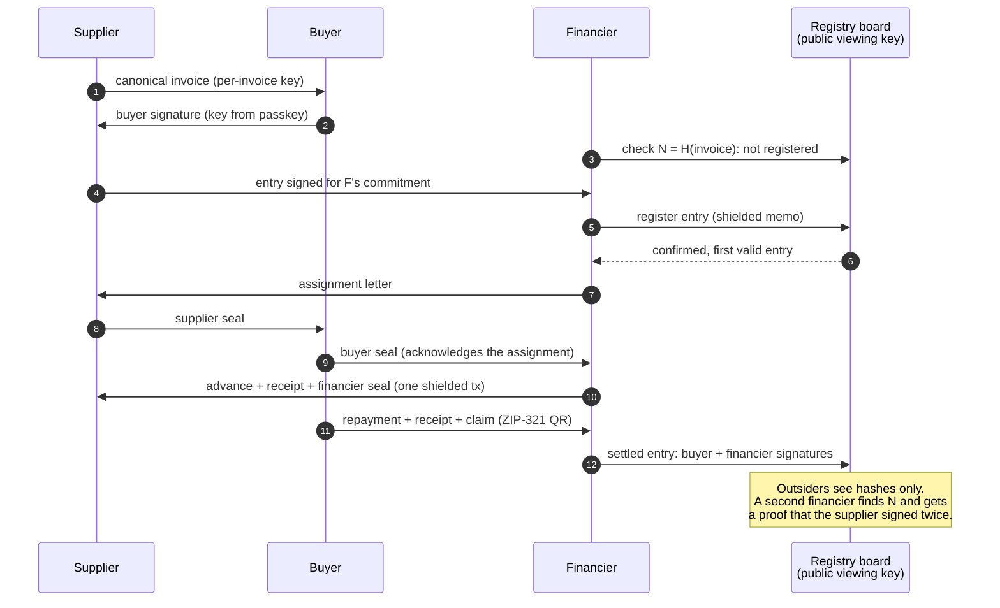
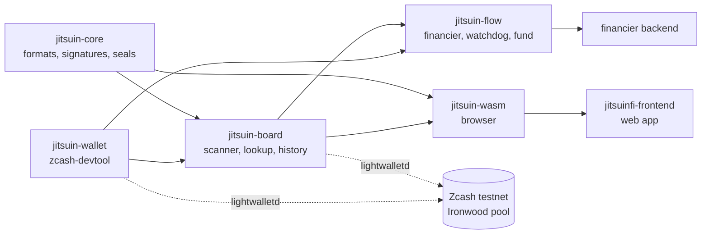

# jitsuinfi-zcash

Zcash protocol and integration layer for **JitsuinFi**, private invoice financing without double financing.

> Zcash stops double-spending. JitsuinFi stops double-financing.

Crates:
- `crates/jitsuin-core`: canonical invoices, nullifier, board entries, receipts, Jitsuin Seal (chained multi-party signatures), assignment letter, settlement, buyer history chain, verification bundle, double-signature proof. Pure logic, no network.
- `crates/jitsuin-wallet`: wallet backend wrapping `zcash-devtool` (sync, ZIP-321 payments with memos, transaction listing).
- `crates/jitsuin-board`: registry board scanner (watch-only wallet + lightwalletd), ordering, double financing lookup, settled entries, buyer history checks. Network code behind the default `net` feature.
- `crates/jitsuin-flow`: role flows: financier state machine with Sign-to-Pay, supplier and buyer helpers, repayment watchdog, minimum standard before registration.
- `crates/jitsuin-wasm`: the browser side: buyer keys from a passkey PRF output, invoice and letter signing, repayment QR, client-side verification of bundles, proofs and histories.

## How it works





## Specification

[Shielded Receivable Registry](docs/zip-shielded-receivable-registry.md): ZIP-style specification of every format and rule, with test vectors asserted by the unit tests.

## Build the browser package

```bash
rustup target add wasm32-unknown-unknown
cargo install wasm-bindgen-cli --version 0.2.129 --locked
cargo build -p jitsuin-wasm --target wasm32-unknown-unknown --release
wasm-bindgen --target web --out-dir pkg target/wasm32-unknown-unknown/release/jitsuin_wasm.wasm
```

`pkg/` then holds `jitsuin_wasm.js` and `jitsuin_wasm_bg.wasm` for the frontend. Secrets passed to it (the buyer's master secret, a supplier key) stay in the page; the package does no network I/O.

Status: in development for ZECATHON 2026. Development runs on Zcash testnet (NU7).
