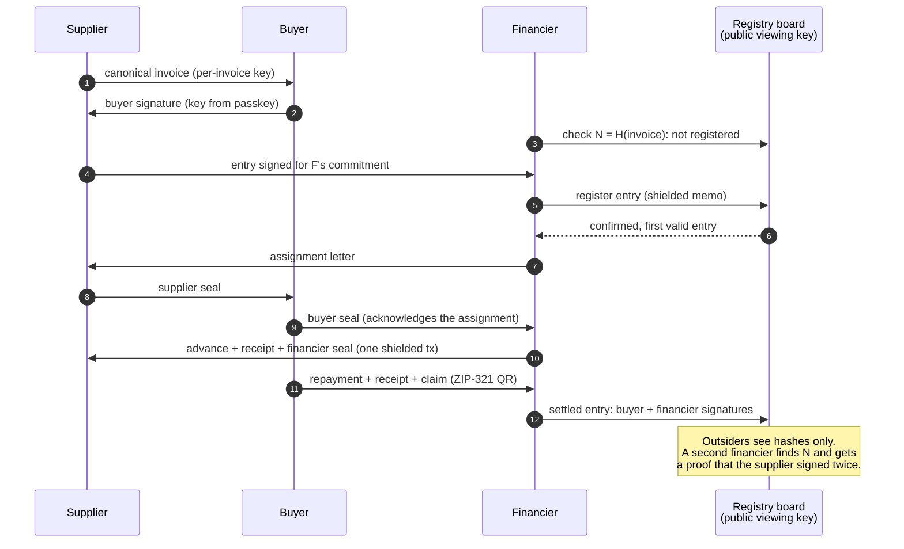
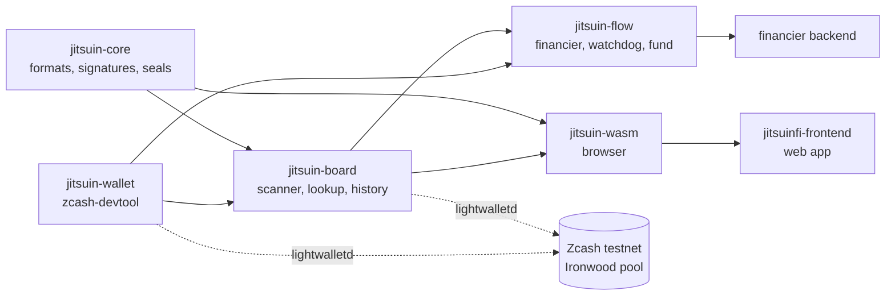

# jitsuinfi-zcash

Zcash protocol and integration layer for **JitsuinFi**, private invoice financing without double financing.

> Zcash stops double-spending. JitsuinFi stops double-financing.

Crates:
- `crates/jitsuin-core`: canonical invoices, nullifier, board entries, receipts, Jitsuin Seal (chained multi-party signatures), assignment letter, settlement, buyer history chain, verification bundle, double-signature proof. Pure logic, no network.
- `crates/jitsuin-wallet`: wallet backend wrapping `zcash-devtool` (sync, ZIP-321 payments with memos, transaction listing).
- `crates/jitsuin-board`: registry board scanner (watch-only wallet + lightwalletd), ordering, double financing lookup, settled entries, buyer history checks. Network code behind the default `net` feature.
- `crates/jitsuin-flow`: role flows: financier state machine with Sign-to-Pay, supplier and buyer helpers, repayment watchdog, minimum standard before registration.
- `crates/jitsuin-wasm`: the browser side: buyer keys from a passkey PRF output, invoice and letter signing, repayment QR, client-side verification of bundles, proofs and histories.
- `crates/jitsuin-cli`: the `jitsuin` command line. `jitsuin verify` scans the board with its viewing key and checks double-signature proofs and verification bundles on it.

## How it works





## Specification

[Shielded Receivable Registry](docs/zip-shielded-receivable-registry.md): ZIP-style specification of every format and rule, with test vectors asserted by the unit tests.

## Build the browser package

```bash
rustup target add wasm32-unknown-unknown
cargo install wasm-bindgen-cli --version 0.2.129 --locked
cargo build -p jitsuin-wasm --target wasm32-unknown-unknown --release
wasm-bindgen --target web --out-dir pkg target/wasm32-unknown-unknown/release/jitsuin_wasm.wasm
```

`pkg/` then holds `jitsuin_wasm.js` and `jitsuin_wasm_bg.wasm` for the frontend. Secrets passed to it (the buyer's master secret, a supplier key) stay in the page; the package does no network I/O.

## Verify the board (`jitsuin verify`)

Anyone can check the registry board without a spending key and without ZEC: the board's viewing key only reads. `jitsuin verify` lists every entry in board order, then checks each double-signature proof (`--proof`) and verification bundle (`--bundle`) against the board. Exit status: `0` every check holds, `1` a check failed, `2` usage, input or network error.

### With Docker

```bash
docker build -t jitsuin .
docker run --rm jitsuin verify --board examples/verify/board-sample.json   --proof examples/verify/proof-sample.txt --bundle examples/verify/bundle-sample.txt
```

The output must equal [`examples/verify/expected-output.txt`](examples/verify/expected-output.txt), ending in `Result   PASS (7 check(s), 0 failed)`. The sample board is synthetic (txids `a1a1…`); `crates/jitsuin-cli/tests/samples.rs` rebuilds it from fixed keys and CI checks it byte for byte.

Live scan of the board. The first run creates a watch-only wallet from the board's UFVK and needs the board's first block; the named volume keeps the wallet, so later runs only sync new blocks:

```bash
docker run --rm -v jitsuin-board:/work/wallet-board-testnet jitsuin verify   --ufvk <BOARD_UFVK> --birthday <BOARD_FIRST_BLOCK>
```

To check your own proof or bundle, mount its folder and pass the path: `-v "$PWD":/in:ro ... --proof /in/proof.txt`.

### With cargo

Rust 1.99.1. The live scan also needs `zcash-devtool` at the commit `jitsuin-wallet` is tested against:

```bash
cargo install --locked --git https://github.com/zcash/zcash-devtool --rev b532d4cd760d30213c961fe0638ee6b6e1bf8e30 zcash-devtool
cargo install --locked --path crates/jitsuin-cli
jitsuin verify --board examples/verify/board-sample.json --proof examples/verify/proof-sample.txt --bundle examples/verify/bundle-sample.txt
```

`jitsuin verify --help` lists every option (`--wallet-dir`, `--devtool` or `$JITSUIN_DEVTOOL`, `--lightwalletd`, `--save-board` to write a snapshot after a live scan, `--json`).

Status: in development for ZECATHON 2026. Development runs on Zcash testnet (NU7).
