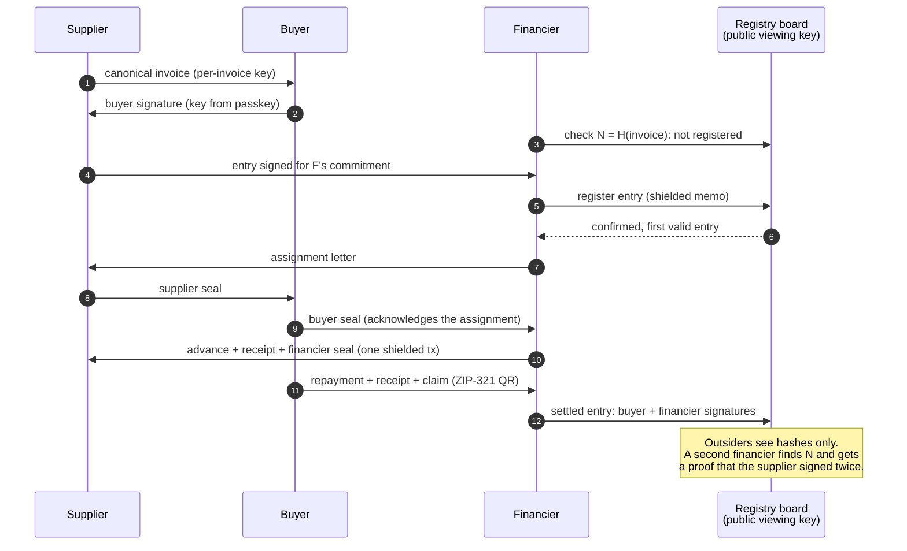
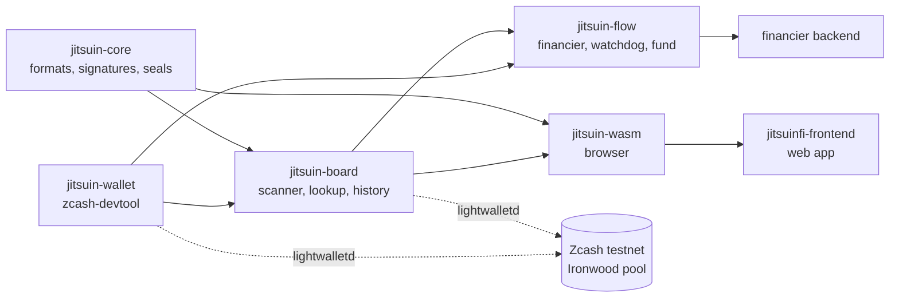

# jitsuinfi-zcash

Zcash protocol and integration layer for **JitsuinFi**, private invoice financing without double financing.

> Zcash stops double-spending. JitsuinFi stops double-financing.

Crates:
- `crates/jitsuin-core`: canonical invoices, nullifier, board entries, receipts, Jitsuin Seal (chained multi-party signatures), assignment letter, settlement, buyer history chain, verification bundle, double-signature proof. Pure logic, no network.
- `crates/jitsuin-wallet`: wallet backend wrapping `zcash-devtool` (sync, ZIP-321 payments with memos, transaction listing).
- `crates/jitsuin-board`: registry board scanner (watch-only wallet + lightwalletd), ordering, double financing lookup, settled entries, buyer history checks. Network code behind the default `net` feature.
- `crates/jitsuin-flow`: role flows: financier state machine with Sign-to-Pay, supplier and buyer helpers, repayment watchdog, minimum standard before registration.
- `crates/jitsuin-wasm`: the browser side: buyer keys from a passkey PRF output, invoice and letter signing, repayment QR, client-side verification of bundles, proofs and histories.
- `crates/jitsuin-cli`: the `jitsuin` command line. `jitsuin verify` scans the board with its viewing key and checks double-signature proofs and verification bundles on it.

## For judges: verify the testnet board

The registry board is a receive-only shielded account on Zcash testnet. Its unified full viewing key (UFVK) is published on purpose: it reads every board memo and cannot spend. You need no spending key, no ZEC and no account, and nothing here asks the team anything.

| | |
|---|---|
| Network | Zcash testnet |
| Board UFVK | [`examples/testnet/board-ufvk.txt`](examples/testnet/board-ufvk.txt) (`uviewtest1…`) |
| Birthday (first block of the board) | `4508703` |
| Double-financing proof | [`examples/testnet/proof-tes-inv-0003.txt`](examples/testnet/proof-tes-inv-0003.txt) |
| Exhibit A (the same double signature without the invoice) | [`examples/testnet/exhibit-tes-inv-0003.txt`](examples/testnet/exhibit-tes-inv-0003.txt) |
| Board snapshot | [`examples/testnet/board-snapshot.json`](examples/testnet/board-snapshot.json), entries up to block 4511024, captured 2026-10-20 |

**1. Scan the live board and check the proof.** From the repository root:

```bash
docker build -t jitsuin .
docker run --rm -v jitsuin-board:/work/wallet-board-testnet jitsuin verify --ufvk "$(cat examples/testnet/board-ufvk.txt)" --birthday 4508703 --proof examples/testnet/proof-tes-inv-0003.txt
```

The first run creates a watch-only wallet and syncs from block 4508703 (about 20 s on 2026-10-20); the volume keeps it for later runs. The output lists every entry in board order and ends with:

```
  PASS  first entry: on the board at 4509299/2/0 (txid 33b8f3b0aa754e790e9c7fac0ae7dc08ce8612a8c26620d551d790e1ea390a56)
  PASS  second entry: on the board at 4509521/3/0 (txid 05d5aa7a02a33c14d460922468745fb4d6d814daa83989eed22b21c0540c79eb)
  PASS  order: the first entry came before the second
  => DOUBLE FINANCING PROVEN

Result   PASS (4 check(s), 0 failed)
```

What it shows: for test invoice `TES-INV-0003-1792179703`, signed by the buyer, the supplier's key signed the same invoice nullifier (N `56edc4f5ed4b…`) for two different financiers. Entry A (block 4509299) registered first; entry B (block 4509521) is the second attempt, and the second financier's lookup reports it as double financed. Lines marked `rejected` are board outputs whose memo is not a valid entry: anyone can send to the board, so the verifier lists such memos and ignores them. Exit status `0` means every check holds.

**2. Recompute the public rate index** from the same wallet:

```bash
docker run --rm -v jitsuin-board:/work/wallet-board-testnet jitsuin index --ufvk "$(cat examples/testnet/board-ufvk.txt)" --birthday 4508703
```

On 2026-10-20 it ends with (a later scan may count entries posted since):

```
         9 register entries, 6 invoices (each N once, first entry), 0 not disclosed, 0 invalid

  tenor          invoices  median discount  discount classes (invoices)
  <= 30 days     -         -                fewer than 5 invoices
  31-60 days     -         -                fewer than 5 invoices
  61-90 days     -         -                fewer than 5 invoices
  91-180 days    -         -                fewer than 5 invoices
  181-365 days   -         -                fewer than 5 invoices
```

The testnet board then held 6 invoices, so every tenor class shows `fewer than 5 invoices`: a class is published only from k = 5 invoices, which keeps single deals from being read off the index.

**3. Offline, without the network.** The image holds the snapshot, so no volume is needed:

```bash
docker run --rm jitsuin verify --board examples/testnet/board-snapshot.json --proof examples/testnet/proof-tes-inv-0003.txt
docker run --rm jitsuin index --board examples/testnet/board-snapshot.json
```

They print exactly [`examples/testnet/expected-output.txt`](examples/testnet/expected-output.txt) and [`examples/testnet/expected-index.txt`](examples/testnet/expected-index.txt); `cargo test` in CI checks both files byte for byte. Add `--save-board mine.json` to the live scan in step 1 to write your own snapshot; it holds the same entries, plus any posted after the capture.

**4. In the browser:** open the Verify page at <https://jitsuinfi.vercel.app/app.html#/verify>, paste the proof text, choose the board snapshot (or your own from step 3) as board data and press Verify. The page runs the same checks compiled to WebAssembly, in the page, and gives the same verdict.

Without Docker, see [With cargo](#with-cargo) below and run the same commands with `jitsuin` instead of `docker run … jitsuin`.

## How it works





## Specification

[Shielded Receivable Registry](docs/zip-shielded-receivable-registry.md): ZIP-style specification of every format and rule, with test vectors asserted by the unit tests.

## Build the browser package

```bash
rustup target add wasm32-unknown-unknown
cargo install wasm-bindgen-cli --version 0.2.129 --locked
cargo build -p jitsuin-wasm --target wasm32-unknown-unknown --release
wasm-bindgen --target web --out-dir pkg target/wasm32-unknown-unknown/release/jitsuin_wasm.wasm
```

`pkg/` then holds `jitsuin_wasm.js` and `jitsuin_wasm_bg.wasm` for the frontend. Secrets passed to it (the buyer's master secret, a supplier key) stay in the page; the package does no network I/O.

## Verify the board (`jitsuin verify`)

Anyone can check the registry board without a spending key and without ZEC: the board's viewing key only reads. `jitsuin verify` lists every entry in board order, then checks each double-signature proof (`--proof`), Exhibit A (`--exhibit`, the proof without the invoice: shareable, it shows the key signed N twice on the board but not which invoice) and verification bundle (`--bundle`) against the board. Exit status: `0` every check holds, `1` a check failed, `2` usage, input or network error.

### With Docker

```bash
docker build -t jitsuin .
docker run --rm jitsuin verify --board examples/verify/board-sample.json   --proof examples/verify/proof-sample.txt --bundle examples/verify/bundle-sample.txt
```

The output must equal [`examples/verify/expected-output.txt`](examples/verify/expected-output.txt), ending in `Result   PASS (7 check(s), 0 failed)`. The sample board is synthetic (txids `a1a1…`); `crates/jitsuin-cli/tests/samples.rs` rebuilds it from fixed keys and CI checks it byte for byte.

Live scan of the board. The first run creates a watch-only wallet from the board's UFVK and needs the board's first block; the named volume keeps the wallet, so later runs only sync new blocks:

```bash
docker run --rm -v jitsuin-board:/work/wallet-board-testnet jitsuin verify   --ufvk "$(cat examples/testnet/board-ufvk.txt)" --birthday 4508703
```

To check your own proof or bundle, mount its folder and pass the path: `-v "$PWD":/in:ro ... --proof /in/proof.txt`.

### With cargo

Rust 1.99.1. The live scan also needs `zcash-devtool` at the commit `jitsuin-wallet` is tested against:

```bash
cargo install --locked --git https://github.com/zcash/zcash-devtool --rev b532d4cd760d30213c961fe0638ee6b6e1bf8e30 zcash-devtool
cargo install --locked --path crates/jitsuin-cli
jitsuin verify --board examples/verify/board-sample.json --proof examples/verify/proof-sample.txt --bundle examples/verify/bundle-sample.txt
```

`jitsuin verify --help` lists every option (`--wallet-dir`, `--devtool` or `$JITSUIN_DEVTOOL`, `--lightwalletd`, `--save-board` to write a snapshot after a live scan, `--json`).

## Public rate index (`jitsuin index`)

"Price public, participants private": each register entry carries a discount class and a tenor class, never an amount or a party. `jitsuin index` recomputes the index from the same board sources as `verify` (`--ufvk` or `--board`). Each invoice counts once, with its first entry in board order. A tenor class, and a discount class inside it, is shown only when it has at least **k = 5** invoices (`--k` can raise it, not lower it).

```bash
jitsuin index --board examples/index/board-sample.json
```

Expected output: [`examples/index/expected-output.txt`](examples/index/expected-output.txt). `--json` adds the class table for the web page.

| code | discount (face - advance) / face | tenor (advance to due date) |
|------|----------------------------------|-----------------------------|
| 0    | not disclosed                    | not disclosed               |
| 1    | < 1%                             | <= 30 days                  |
| 2    | 1-2%                             | 31-60 days                  |
| 3    | 2-3%                             | 61-90 days                  |
| 4    | 3-5%                             | 91-180 days                 |
| 5    | 5-8%                             | 181-365 days                |
| 6    | 8-12%                            |                             |
| 7    | >= 12%                           |                             |

`jitsuin_core::index::classes_for(face, advance, advance_day, due_day)` gives the two codes of a deal. Entries are `0/0` (not disclosed) by default: anyone holding the invoice (the buyer, a financier that was shown it) can compute `N` and read that entry's classes, so the supplier opts in before its classes join the index. A financier accepts either the deal's classes or `0/0`. Both are disclosed or neither; other values are counted as invalid and left out.

Status: in development for ZECATHON 2026. Development runs on Zcash testnet (NU7).
